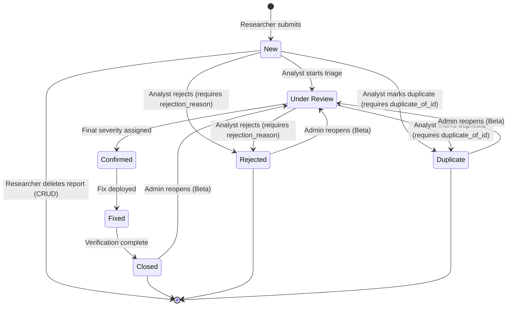

## 1. System Scope & Role Definitions

VulnDesk is an access-controlled vulnerability intake, triage, and tracking web application. It enables security researchers to submit and manage vulnerability reports, security analysts to triage and verify findings, and administrators to govern accounts.

### Global Roles
* **`researcher`:** Submits vulnerability reports, views own reports, updates or deletes own reports while in `New` status, views analyst rejection reasons, and comments publicly.
* **`analyst`:** Views all reports, assigns `final_severity`, transitions report status along allowed state paths, records rejection reasons or duplicate references, and writes analyst-only internal notes.
* **`admin`:** Manages accounts, reopens end-state reports (`Beta`), and browses system statistics.

In the **MVP**, the acting user is selected from seeded demo accounts via the `X-Demo-User` HTTP header (`DEMO_MODE=true`). In the **Beta**, this is replaced by JWT access tokens and HTTP-only refresh cookies.

---

## 2. Report State Machine & Allowed Transitions

